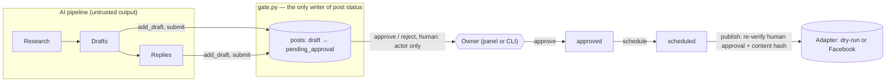

# orkiestrator

> Human-in-the-loop AI social media team for one person.
> AI researches, drafts posts and replies; **nothing goes public until a human clicks Approve.**

Status: working prototype, extracted from a private project with a fictional demo brand ("Ziarnko", a
coffee roastery). Publishing is dry-run for every platform except an opt-in Facebook adapter that has
only been tested against a mock HTTP call, never a real Page.

- **Zero runtime dependencies.** The package itself is Python standard library only.
- **139 tests**, `python -m unittest discover -s tests`, including negative tests for the approval gate.
- **Runs with no API key and no network**: `ORKI_PROVIDER=demo` (see [Try it without a key](#try-it-without-a-key)).
- Built with [Claude Code](https://claude.com/claude-code): role subagents in [`.claude/agents/`](.claude/agents/)
  are *denied* the approve/reject commands and any write to the queue database in [`.claude/settings.json`](.claude/settings.json).

## Why this exists

A one-person brand doesn't need an agency, but it does need research, drafts, and replies written
every day — work that's tedious to do from scratch and risky to fully automate. This project tries a
narrow answer: let AI do the writing, and make the one-way door (publishing) impossible to open without
a human.

## Trust boundary



Everything left of the gate is written by `agent:*` actors and can only reach `draft` or
`pending_approval`. Everything right of it requires an actor string starting with `human:`, which only
the owner's CLI session or an authenticated panel request can produce. `schedule` and `publish`
re-check that approval — including a content hash — immediately before any platform call, not just the
status column (see [`SECURITY.md`](SECURITY.md) for exactly what that does and doesn't guarantee).

## Quick start

Needs Python 3.10+. Verified on a clean clone:

```bash
git clone https://github.com/RG-automations/orkiestrator.git
cd orkiestrator
python3 -m pip install -e .
ORKI_PROVIDER=demo python3 -m orkiestrator serve
```

Open the URL it prints (includes a one-time token). Linux/macOS: `./start.sh`. Windows: `start.bat`.

### Try it without a key

`ORKI_PROVIDER=demo` swaps the real LLM calls for fixed, canned answers shaped like the real prompts
(see [`demo.py`](src/orkiestrator/demo.py)) — no network call, no cost, no account. Click through
**Research → Tydzień treści → Odpowiedzi** on the Start page, then approve or reject what shows up in
**Kolejka**. The demo brand ("Ziarnko") and all its data (`knowledge/`, `inputs/`) are fictional.

To use a real model instead, set `GEMINI_API_KEY` (free tier at [aistudio.google.com](https://aistudio.google.com/api-keys))
or `ANTHROPIC_API_KEY` in `local.env` (copy from `local.env.example`).

## What's real and what's dry-run

| Platform | Status |
|---|---|
| Facebook (Page) | Real Graph API adapter, opt-in. Needs `FB_PAGE_ID` + `FB_PAGE_TOKEN` and the owner typing `OPUBLIKUJ NAPRAWDE` in the panel. **Tested against a mock HTTP call only** — not verified against the real API. |
| Instagram, YouTube, LinkedIn, TikTok | Dry-run. An approved post is written to `data/outbox/<platform>-<id>.json`. No real adapter exists. |

## Project structure

```
src/orkiestrator/
  gate.py          the state machine: draft → pending_approval → approved → scheduled → published | rejected
  web.py           owner panel (127.0.0.1, token auth, CSRF origin check)
  cli.py           python -m orkiestrator add|submit|approve|reject|list|schedule|publish-due|brief
  pipeline.py      research / content / replies — takes any llm(system, prompt) -> str
  ai.py / demo.py  Gemini, Claude, or the offline demo provider
  brain.py         the morning loop (research, content, replies, brief, in priority order)
  interrupts.py    alert rules (trend spike, competitor spike, buying intent, negative comment, ...)
  scheduler.py     next publishing slot per platform, from knowledge/platforms/*.md
  publisher.py     background loop; only ever calls adapters for gate-approved, hash-verified posts
  adapters/        Publisher interface; DryRunPublisher + FacebookPublisher
knowledge/ inputs/   brand voice, offer, platform rules, audience data (demo content here)
tests/               python -m unittest discover -s tests
.claude/ CLAUDE.md    Claude Code subagent setup; agents are denied approve/reject and queue.db writes
```

## Development

```bash
python3 -m unittest discover -s tests   # 139 tests, ~20s
ruff check .                            # lint (config in pyproject.toml)
```

`tests/test_hitl.py` is the one worth reading first: it tries to approve as a non-human actor, forge a
`scheduled` status without approval, tamper with content after approval, replay a stale approval hash,
and bypass the panel's session/origin checks — and asserts every one of those is refused.

## License

[MIT](LICENSE).

## Author

Rafał Glinka — [github.com/RG-automations](https://github.com/RG-automations)
